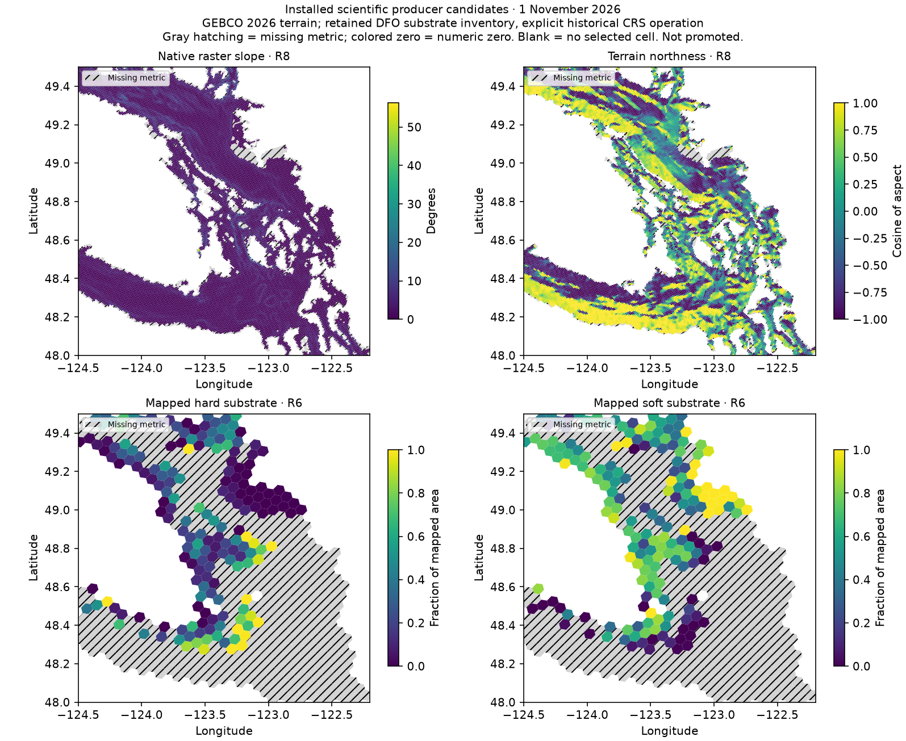

# Installed producer validation — 1 November 2026

The packaged terrain and mapped-substrate workflows now produce metric-only candidate
tables from retained scientific inputs, without a historical audit-output dependency.
No delivered file/catalog was replaced. The Data Explorer was not started.

## Real-source acceptance

| Installed producer | Rows | Time | Peak RSS | Comparison |
| --- | ---: | ---: | ---: | --- |
| Mapped substrate, historical CRS, R6 | 2,427 | 135.56 s | 1.50 GiB | All three exported metrics and 13 comparable native fields exactly match historical values/nulls |
| Mapped substrate, historical CRS, R8 | 81,380 | 174.57 s | 1.35 GiB | Same exact comparison |
| Terrain R8 | 81,380 | 101.90 s | 1.51 GiB | All eight exported metrics pass unchanged tolerances; every native null mask matches |
| Mapped substrate, current default CRS | 64 selected real R6 cells | 20.65 s | 0.66 GiB | All 13 native fields exactly match the retained unchunked current-operation reference |

The two full substrate runs used all 346,972 retained DFO inventory records, indexed
in bounded batches. The current-operation check includes 32 cells with mapped fractions
and 32 null cells; it is a bounded acceptance check, not a new full-area current-CRS run.
R6 membership is pinned to the approved study registry; R8 uses the retained 81,380-cell
scientific model support. Source byte hashes and exact commands are recorded below.

Each stage enforced 2 GiB process RSS, a 600-second wall-clock limit and at least 20 GiB
free disk. All passed; about 81 GiB remained free. Sleep inhibitors were scoped to the
runs and released afterward. The historical CRS option is explicit; the default remains
current PROJ selection. Empty spatial intersections use no substitute record and retain
null mapped metrics. See [commands and source requirements](packaged-source-reproduction.md).

## Terrain precision: qualified reproduction, not bit identity

Acceptance remains `atol=1e-6` plus `rtol=1e-9`, in each field's unit. All eight public
terrain metrics pass, with identical keys/nulls. The expanded native diagnostics have
13 tolerance exceedances in 11 cells:

| Native field | Exceedances | Maximum historical difference |
| --- | ---: | ---: |
| Aspect | 3 | 4.3624e-6 degrees |
| Ring-1 circular mean aspect | 4 | 6.9039e-6 degrees |
| Ring-2 neighborhood roughness | 5 | 1.0977e-5 m |
| Ring-4 neighborhood roughness | 1 | 5.5735e-6 m |

Independent 60-digit OLS calculations on the exact current binary64 inputs support all
13 current values over the historical values. Direct aspect error is at most 5.1e-11
degrees; circular means recomputed from precise planes differ by at most 2.3e-10 degrees;
roughness error is at most 1.01e-8 m. Nearly flat gradients and four-point, nearly collinear
roughness fits amplify rounding. Depth centering improves plane fitting without changing
the OLS definition, flat-aspect threshold, scientific source or acceptance tolerances.
The historical numerical environment was not recorded, so these results do not establish
its exact coordinate/library identity. Historical bit parity is not claimed or forced.

Native raster slope was recomputed from the actual raster. Window halos preserve the
original central/edge stencils, marine masks and quantiles; a whole-raster reference test
matches exactly across window boundaries, land, nodata and raster edges. Bounded graph
calculation likewise matches its full reference exactly. No historical terrain or exported coverage/audit table
was used as a producer input.

## Metric-only outputs and missing support

Static tables contain `h3_index` plus scientific metrics. Dynamic exports add `date`.
No coverage, audit, status or provenance columns are added. Units and temporal precision
remain metadata; optional native diagnostics/source receipts are separate. Historical
native audits were read **only after production for comparison**, not by either producer.
See [the export contract](metric-only-exports.md).

The three R6 cells without retained nearshore/coast-complexity support remain explicitly
listed in diagnostics, not filled: `861299397ffffff`, `86129955fffffff`,
`8628f1617ffffff`. This limitation is family-specific: mapped substrate has its own valid
water-polygon support for all 2,427 requested R6 cells.

## Evidence and reproducible commands

Persistent evidence root: `.seascape/work/installed-producer-validation-20261101/`.
The earlier Codex task directory was absent on reconnect. Repository changes and retained
sources survived; the wheel and these acceptance candidates were rebuilt rather than
assuming the interrupted run succeeded.

- `*-command.json`: exact installed commands and input hashes.
- `*-status.json`: return code, elapsed time, peak RSS and guard outcome.
- `comparisons.json`: field-by-field values/nulls and direct high-precision evidence.
- `circular-precision.json`, `current-crs-comparison.json`: additional reference checks.
- `code-receipts.json`, `staging-manifest.json`: code/wheel identities and owned storage.
- `substrate-r6-candidate/`, `substrate-r8-candidate/`, `terrain-candidate/`: separate final-schema candidates.
- `substrate-*-work/`, `terrain-workspace/native/`: optional native diagnostics and receipts.

Installed wheel SHA-256: `244bce5a9813d6f39ad04470d53a8055154dae6b63a10c43d66b3beb14d8d6c4`.
Generic portable commands and explicit source bindings are in
[packaged source reproduction](packaged-source-reproduction.md). The exact local commands
are evidence, not paths required by the package.

## Checks and remaining limits

The suite passed 714 tests, with three expected skips requiring regional artifacts.
Lint, formatting, the configured 21-module type check, 23 outside-checkout installed
regressions, 215 installed-module imports and the installed validation notebook passed.
The notebook made no acquisition/network attempts. Documentation links are checked offline.
MkDocs is unavailable in the rebuilt validation environment; a fresh strict site build
was not run because this session permits no new downloads. Hosted CI, vulnerability
service checks and full provider acquisition were not run.

This closes the packaged producer integration and the requested installed replays; it
does not establish complete upstream regeneration of all 17 families. The
[full-study matrix](full-study-reproduction.md) retains the other limits: complete classified
BC shoreline inventory, qualified cross-border estuary sources, the original anthropogenic
water mask/full inventory and positive reef evidence; full raw network, R6 bathymetry/
isobath and modeled-substrate current-support production remain unrun as previously listed.
Denied source endpoints were not retried. No commits, pushes, publication or candidate
promotion occurred.

## Example maps

The example uses full H3 polygons as display geometry in a bounded Salish Sea view;
substrate fractions are conditional on mapped water area, not whole-cell coverage.
Missing metrics are hatched gray; numeric zero retains its numeric color.



```bash
python scripts/render_producer_maps.py --terrain .seascape/work/installed-producer-validation-20261101/terrain-candidate/terrain-r8-static.parquet --substrate .seascape/work/installed-producer-validation-20261101/substrate-r6-candidate/mapped-substrate-classes-r6-static.parquet --output docs/assets/reproduction-20261029/installed-producers-20261101.png
```
