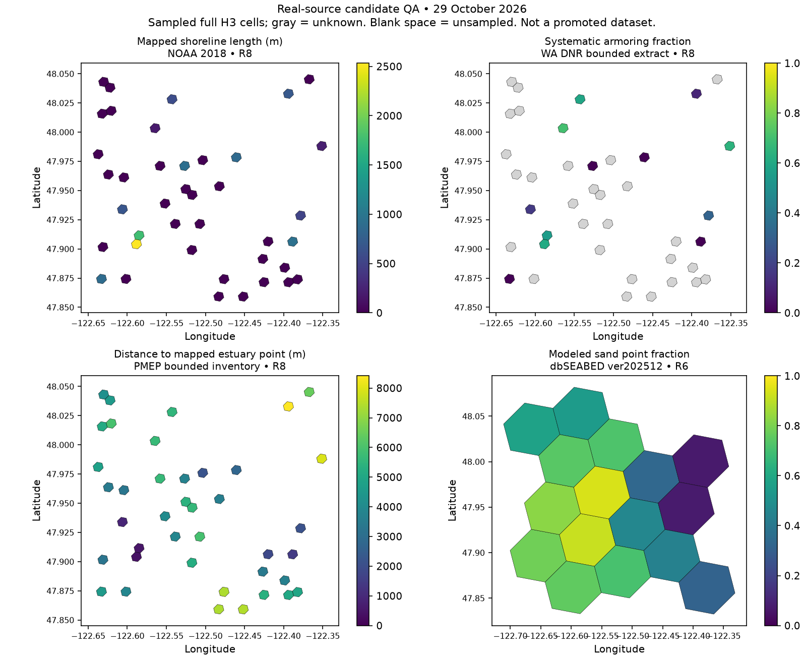

# Source-bound regional candidates

The `seascape regional --spec spec.json [--preflight]` interface runs four bounded
scientific operators from explicitly qualified, SHA-256-pinned local inputs.
Candidates are separate scratch outputs, never a replacement for `Data/Seascape`.
This interface recovers the relevant operators from revision `9b20b3d` without
restoring its legacy publication workflow. Acquisition remains separate.

The 2026-11-01 armoring rule supersedes the earlier v3 conflict-to-null policy:
deliver the maximum available dataset cell estimate, keeping all-missing null.
Regional manifests identify `native_physical_anthropogenic_maximum_dataset_v4`.
Earlier comparisons below are historical evidence for their recorded methods;
they do not validate new regional values under this rule. Final compact exports
omit the candidate's internal diagnostics. See [combination rules](metric-only-exports.md).

| Operator | Required inputs | Native grain and semantics |
| --- | --- | --- |
| shoreline | reporting keys, support points, normalized classified line inventory | R6 or R8 full H3; unique mapped and classified line lengths in m; nonexclusive class fractions; unknown classification remains unknown |
| anthropogenic | reporting keys, normalized inventory, qualified water polygons | R6 or R8 full H3; positive mapped evidence, water-clipped areas in m², systematic armoring length fraction; absent inventory evidence remains null |
| substrate | R6 reporting keys, valid in-cell water representative points, rock/gravel/sand/mud rasters | Direct native R6 bilinear point samples; rock score separate from sediment fractions; missing raster neighbors are renormalized and recorded |
| estuary | R8 reporting keys, qualified normalized point inventory | EPSG:32610 Euclidean distance in m from H3 centers to representative estuary points; finite inventory only, no network or boundary distance |

Use agency/public source rights and attribution from the applicable
`src/seascape/**/DATA_SOURCES.md`. Source qualification must explicitly record
rights, spatial support, coverage status and observation period (null if unknown).
A recorded rights string is a user assertion, not automated licence approval.
Do not treat new downloads as the historical vintage without byte/provenance evidence.
Invalid native geometries are rejected; projection-only precision repair is bounded
and reported. No observed absence or global coverage is inferred.

Each JSON spec has `schema: 1`, `operator`, `resolution`, `output` (a new directory),
`domain` (`id`, `revision`, `support`, `coverage_status`), and `inputs`. Each input
has `path`, raw `sha256`, and `qualification` with the four fields above. Directory
pins hash a sorted component manifest. `reporting` is sorted unique H3 IDs, one
per line. `support` is Parquet with H3_INDEX, REPRESENTATIVE_POINT_LONGITUDE,
REPRESENTATIVE_POINT_LATITUDE, HAS_WATER_OVERLAP=true and
IS_HIERARCHY_ONLY_PARENT=false. Estuary inventory is Parquet with unique SOURCE_ID
and finite X_M/Y_M. Source adapters must establish the inventory qualification
before running the operator; a different source extent changes distance semantics.

Optional `limits` lower the default ceilings of 1.5 GiB RSS, 512 MiB candidate
output, one hour and 4096 batch rows. One main-thread worker runs. Preflight hashes
inputs but creates no candidate. Execution rechecks pins, emits metrics.parquet,
MANIFEST.json and CHECKSUMS.sha256, or preserves FAILED.json. Manifests state
source-scoped candidate status and include code identity, timings and input rights.
These companions belong in scratch, not consumer delivery.

The public compact anthropogenic 0/1 fill remains a separate approved projection
in `reviewed_delivery`; the native producer keeps unknowns. Do not fill native
nulls to make comparisons pass. Shoreline fractions can sum above one because
class evidence overlaps. Substrate is point support, not H3 areal composition.

Software tests use offline fixtures. Real-data validation and historical-parity
claims must separately identify sources, keys, compared fields and discrepancies.
The portable validation notebook remains the existing bathymetry/client example;
it does not certify these source-dependent regional candidates.

## Verified real-source results — 2026-10-29

The installed 0.1.1 wheel ran six candidate jobs, sequentially, from outside the
checkout. Sources were downloaded into `.seascape/cache/reproduction-20261029`;
receipts bind URLs, timestamps and bytes. Original delivery and audits were read only.

| Pathway | Result | Practical limit |
| --- | --- | --- |
| WA physical shoreline | 16 R6 + 40 R8 cells; 20 numeric measurement/diagnostic fields and null masks match | NOAA 2018 source; BC follow-up below; separate shoreline-distance output not replayed |
| Anthropogenic | 16 R6 + 40 R8 cells; all 28 nonnull armoring fractions match, along with native missingness; one positive R6 channel area matches | Different retained water mask changes area fractions; inventory record counts differ because this extract has only two source classes. BC positive aquaculture/disposal follow-up below; positive reef remains untested |
| Modeled substrate | 16 R6 cells; rock/gravel/sand/mud match exactly at retained historical point coordinates; independent scalar raster reads agree | Historical sample coordinates are audit-retained inputs; upstream water-support generation not replayed |
| Estuary | 40 R8 point distances match exactly | 103-point bounded PMEP inventory; BC source qualification and complete cross-border inventory not replayed |

An initial substrate run used the newer retained support points: sediment fractions
differed by up to 0.02234. Replaying the historical audit coordinates removed those
differences exactly. Coordinates are input evidence, not copied target metric values.
Anthropogenic wet areas differ by up to 1,399,977 m² at R6 and 175,012 m² at R8;
these candidates must not replace delivery until the water-mask version is resolved.
No calculation defect in these matching fields was found. A separate missing
harvest-zone classification safeguard was found and restored as described below. The differing
support inputs prevent a blanket historical-parity claim.

The native anthropogenic producer requires a **scientifically qualified inventory**:
`IS_CANONICAL` must reflect physical-presence eligibility, not merely duplicate
selection. Regulatory shellfish areas and licence records cannot be declared physical
footprints solely because they are authoritative. This acceptance uses DNR systematic
shoreline mapping and NOAA mapped channels only. Unknown native values remain null;
existing compact-delivery tests cover the separate approved public 0/1 projection.

HUB Ocean's exact December 2025 dataset metadata reports CC BY 4.0. Four rasters total
103,725,184 bytes. The NOAA shoreline ZIP is 3,062,105 bytes; bounded PMEP, DNR and
NOAA channel GeoJSONs total under 1 MB. A larger truncated DNR response was retained
as acquisition evidence and excluded from scientific runs. Two Washington Ecology
queries returned HTTP 403 (`CoastalAtlas/MapServer/314` aquaculture and `/1116`
disposal); they were not retried or bypassed. BC inputs were subsequently acquired in the bounded follow-up below.

## Repeat the acceptance and maps

Use Python 3.14 with this checkout installed (`python -m pip install '.[test,quality]'`).
The source cache must contain `NOAA_SHORELINES_2018/SHSTMP_PS_Marine_Shorelines_2018.shp`
with all shapefile companions, its ZIP, `WA_ARMORING_SMALL.geojson`,
`NOAA_DREDGED.geojson`, `PMEP_ESTUARY.geojson`, four `DBSEABED_<CLASS>_PERCENT.tif`
rasters and `HUB_SUBSTRATE_STAC.json`. URLs, exact query bounds, source pins and
rights are retained in the evidence below; acquisition is separate from the producer.
Use a new scratch output directory. Run one worker at a time.

```sh
python scripts/replay_real_sources.py \
  --source-cache /absolute/toolkit-seascape/.seascape/cache/reproduction-20261029 \
  --support-root /absolute/retained/workspace/data/processed/domain/environmental_layer/seascape/spatial_support \
  --delivery /absolute/MarineCast/Data/Seascape \
  --historical-substrate-points --output /absolute/new-scratch-output
python scripts/render_candidate_maps.py \
  --input /absolute/new-scratch-output --output /absolute/candidate-maps.png
```

Omit `--historical-substrate-points` to use current retained support for the substrate
candidate. The script normalizes actual source records with package adapters, writes
pinned specs, executes installed CLI preflight and producers, and compares keys,
values and native nulls. Each candidate is at most 40 cells; these checks do not
prove an entire coast or all source types. Existing matched fields are evidence of
semantic parity on selected keys, not byte identity of old files.



Maps show full H3 display geometry, including point-supported substrate values.
Gray means unknown; blank space is unsampled. Source names, units and review date
are shown. The image was inspected at its rendered resolution.

## Evidence and remaining run plan

* [Field comparisons](assets/reproduction-20261029/comparisons.json)
* [Independent substrate check](assets/reproduction-20261029/substrate-independent-check.json)
* [Input, code and candidate manifests](assets/reproduction-20261029/candidate-manifests.json)
* [Acquisition receipts](assets/reproduction-20261029/source-receipts.json)
* [Installed environment](assets/reproduction-20261029/installed-environment.json)

Software validation after the harvest safeguard: 690 tests passed, three existing materialized-data tests skipped;
Ruff checks/format and mypy's 21 interface modules passed. The installed wheel imported
211 modules with OrcaCast imports blocked. Its interpreter used shared installed
scientific dependencies; this is not a new clean dependency-closure certification.
The first full test invocation found stale 0.1.0 environment metadata; rerunning against
the installed 0.1.1 wheel passed. The existing validation notebook executed successfully. Final documentation checks passed: 72 documents, 333 local links, 16 documentation
tests and strict MkDocs build, including the BC addendum.

Before a full-area run, qualify and pin the complete BC/US source inventories,
resolve access to the two Ecology layers or explicitly approve a different source,
recover/rebind the historical anthropogenic water geometry if historical parity is
required, and decide which substrate support vintage to use. The BC follow-up below covers positive aquaculture/disposal cases. Extend acceptance
to positive artificial-reef cases and BC estuary polygons. Then run one family at a time under the recorded resource limits and
review discrepancies before any delivery update. No full-area compute estimate
has been certified from this small sample; raw substrate downloads are already cached.

## Bounded BC follow-up and closure

An additional 701-record complete BC ShoreZone query reproduced 16 R8 cells fully
inside its query extent. The same 20 measurement/diagnostic fields match, with
maximum floating-point length difference 4.55e-13 m and matching null masks.
A broader 1,000-record truncated response was retained but excluded.

The public DFO CSV normalized to 453 licensed shellfish-site points. These establish
mapped site evidence, not cultivation footprint area or present activity. Sixteen
valid ECCC active disposal-site polygons establish mapped approved-site extent,
not proof of recent disposal. Together with the bounded ShoreZone inventory, they
produced 24 R6 and 24 R8 candidate cells: each grid includes 12 positive aquaculture
and 12 positive disposal examples. Independent direct point intersections agree;
independent disposal overlays differ by at most 5.91e-8 m².

The existing `anthropogenic_presentation` API then derived polygon-presence flags
from positive area **and** its linked QC and applied the approved public false-fill.
All four public flags match delivery on all 48 cells (192 flag comparisons). Original
nullable evidence stays in `*_SOURCE_NULLABLE` columns. Comparing those source
nulls directly to already false-filled delivery flags would be the wrong comparison.
There were no positive artificial-reef source records in this acceptance.

Native armoring and area/fraction values from this partial current inventory do not
all match historical products. BC sample wet-area differences reach 7,700,287 m²
at R6 and 595,407 m² at R8; disposal-fraction differences reach 0.003965 and 0.016347,
respectively. The exact historical water mask was not found in the narrowly scoped
source-closure/regional-completion retained geometry files or embedded source
manifest. Ten candidate mask/resolution bindings were inspected. A separate
unsplit-water intersection calculation validates the current WA candidate water
areas within 1.97e-6 m² and verifies its positive-area fraction arithmetic. No exact
historical water-mask identity or full historical anthropogenic parity is claimed.

Git revision `5634dc9`, explicitly referenced in the historical provenance, contains
a safeguard missing from the active branch: Coastal Atlas 314 describes shellfish
harvest/water-quality regulation, including Approved and Prohibited zones. The
restored code/config crosswalk preserves those records as
`shellfish_harvest_classification`, excludes them from physical aquaculture area,
and prevents them from suppressing genuine OSM farm records during deduplication.
Both Approved/Prohibited regression cases pass. The denied service was not queried
again, and no original output was modified. Manual recovery of that layer would
restore regulatory context, not supply physical aquaculture footprints.

```sh
python scripts/replay_bc_sources.py \
  --source-cache /absolute/toolkit-seascape/.seascape/cache/reproduction-20261029 \
  --support-root /absolute/retained/workspace/data/processed/domain/environmental_layer/seascape/spatial_support \
  --delivery /absolute/MarineCast/Data/Seascape --output /absolute/new-bc-scratch
```

Additional cache inputs are `BC_SHOREZONE_COMPLETE.geojson`,
`BC_DFO_SHELLFISH_LICENCES.csv` and `CA_DISPOSAL_SMALL.geojson`. The code uses the
installed producer CLI and existing normalizers/presentation API. Candidate tables,
source pins and comparison reports remain separate from delivery.

* [BC scientific and public-flag comparisons](assets/reproduction-20261029/bc-comparisons.json)
* [BC candidate code/input manifests](assets/reproduction-20261029/bc-candidate-manifests.json)
* [Water-mask candidates and independent overlay check](assets/reproduction-20261029/water-mask-investigation.json)

**Remaining manual inputs:** the original historical water geometry/source binding
for full anthropogenic parity; qualified BC estuary polygons and their exclusion/
normalization evidence; and a permitted artificial-reef inventory containing a
positive example. The bounded OSM request returned HTTP 406 and was not retried
through another endpoint. Ecology 403 sources remain unavailable. These source
access restrictions were service responses, not automatic approval-review denials.
The implementation can produce source-scoped candidates now; complete regional
historical reproduction and delivery replacement remain unapproved/unverified.
