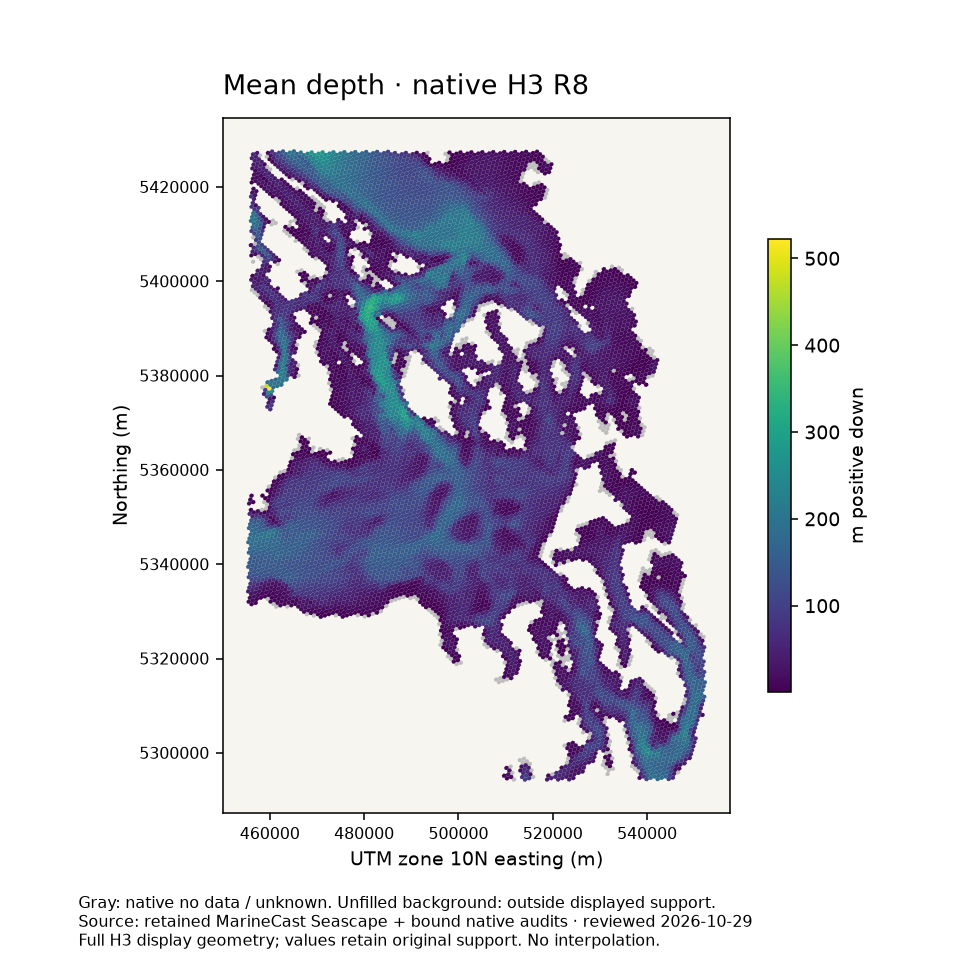
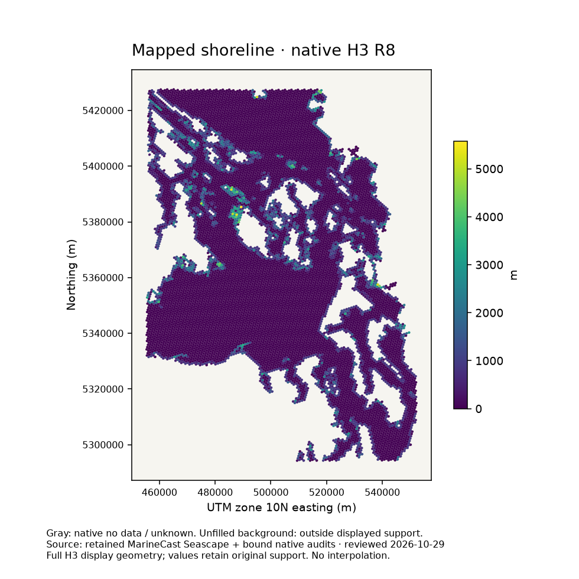
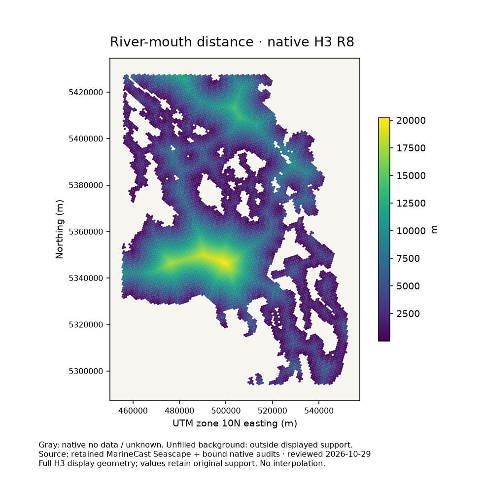
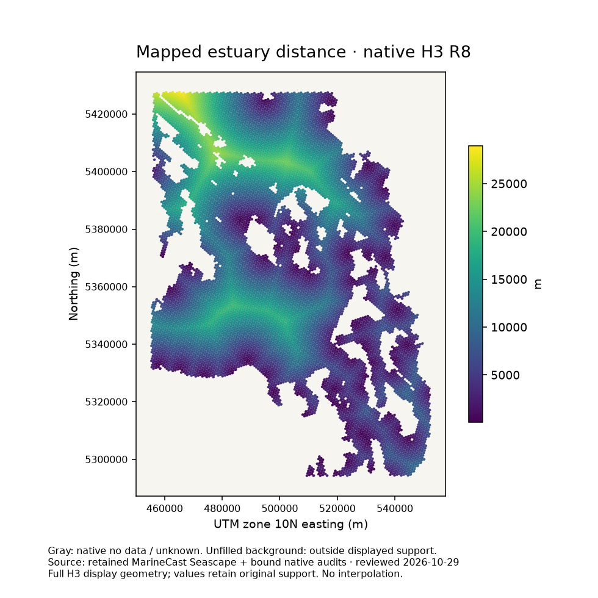
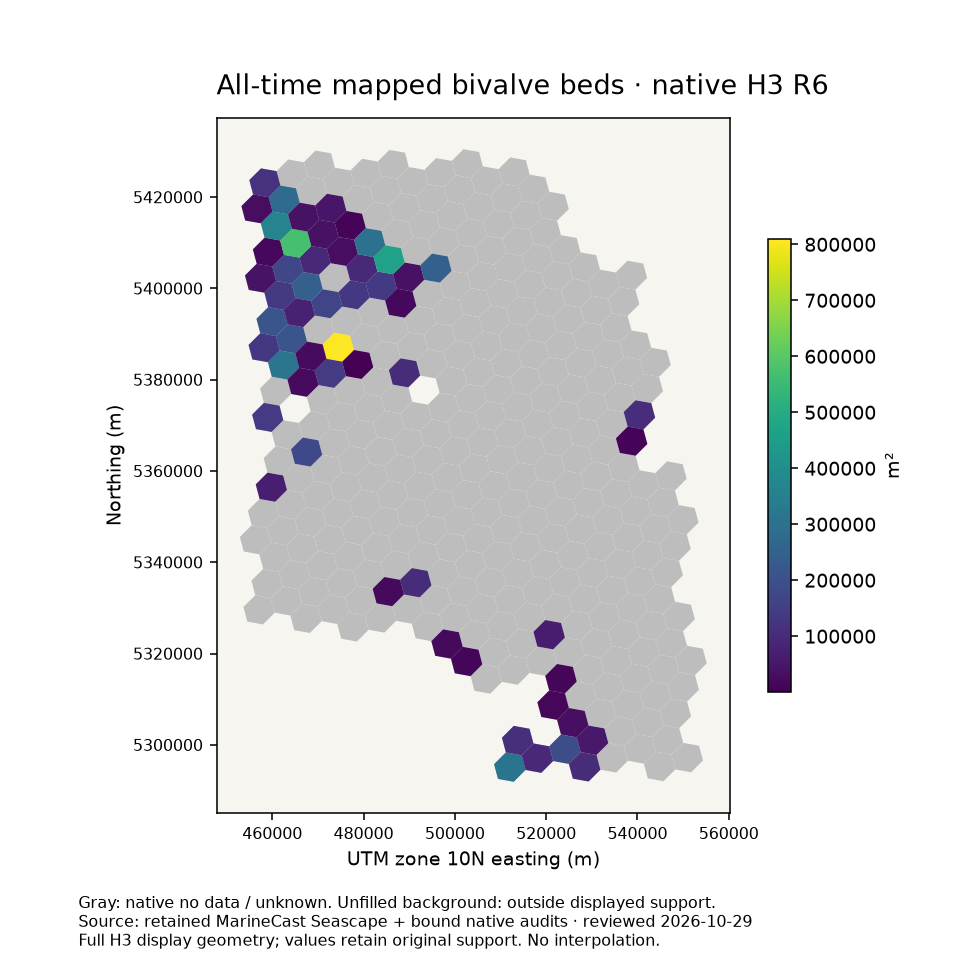
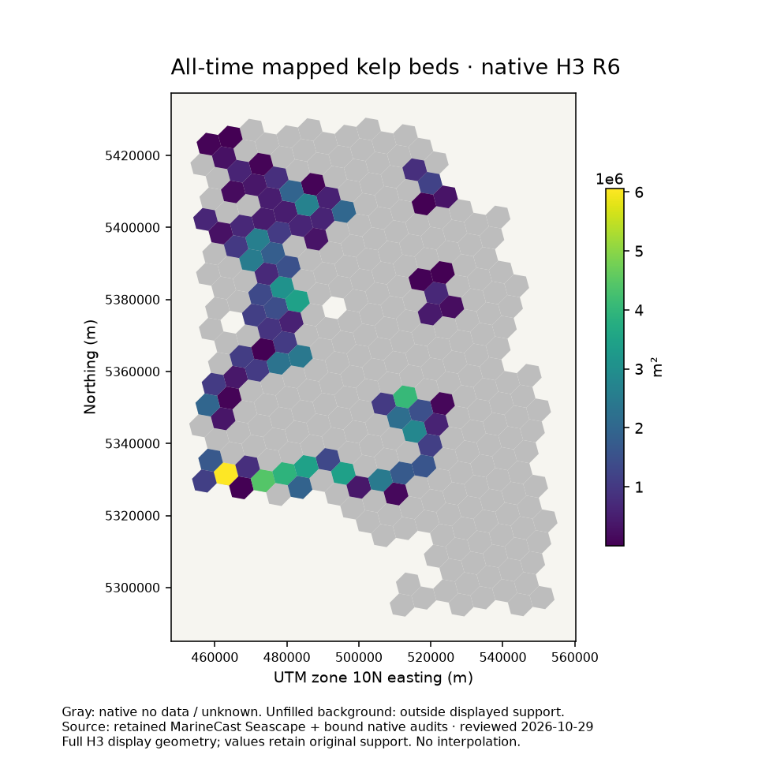
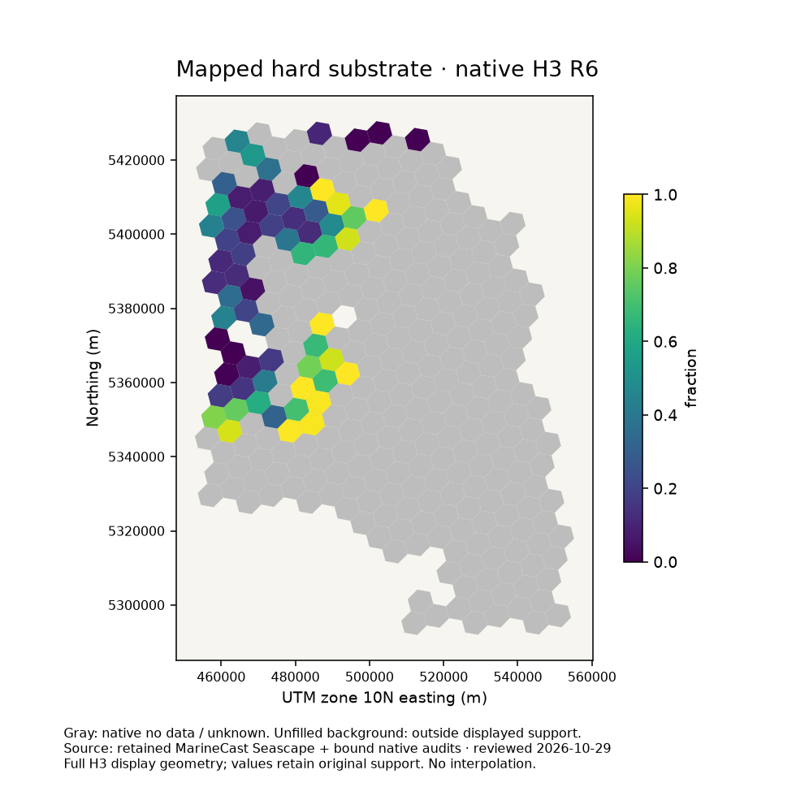

# Delivered-product reproducibility review — 2026-10-29

Current delivery contains **17 families, 29 H3 Parquets (27 static, two annual
Kelp), and 14 research Parquets**. These counts supersede the historical 19-area,
33-variant source-closure snapshot; no products were removed in this review.

The [expanded scientific replay matrix](source-replay-matrix.md) supersedes the
initial one-family scope below and records subsequent source-driven checks and
exact remaining prerequisites for every delivered family.

## What was verified in the initial pass

The current working source was built as toolkit-seascape 0.1.1 and installed into
an isolated target outside the checkout. The checkout already contained uncommitted
compact-delivery changes; HEAD alone does not identify that installation. The [environment record](assets/review-20261029/environment.json)
records installed Python source hashes and dependency versions.

* All 27 static tables restored successfully through `restore_native`, which
  verifies the external audit SHA-256 and recomputes the public projection.
  Public H3 keys were unique. File hashes, columns, rows and null counts are in
  [the evidence record](assets/review-20261029/evidence.json).
* A scientific replay used all retained audited bivalve inventory records and
  40 deterministic R6 cells: first 20 positive and first 20 unknown native cells
  sorted by H3. Production `build_bivalve_extents` regenerated native full-cell
  geometry intersections. Keys and null masks matched; maximum area difference
  was **0 m²** (assertion tolerance 1e-6 m² absolute, 1e-10 relative).
* The current installed package passed **657 tests; three materialized-product
  tests skipped**. Skips are not regional verification.
* Documentation checks passed for 70 documents and 309 local links; 16
  documentation tests passed. Ruff and format checks passed for all 309 Python
  files; mypy passed for 21 interface modules. `mkdocs build --strict` passed
  using isolated documentation dependencies. External URLs were not checked.
* Eight rendered layer examples were inspected for readable legends, units,
  missingness and unclipped labels. They show delivered values, not independent
  source reconstruction.

This establishes compact projection integrity and one bounded scientific replay.
It does **not** establish full-history reproducibility, source acquisition today,
regional scientific accuracy, or byte-identical regeneration. Bivalve provenance
metadata and every scientific field were not compared in the bounded replay.
Subsequent scientific replays are recorded separately in the expanded matrix.

## Repeat the checks and maps

Use Python 3.14 with the current package installed (`python -m pip install
'.[test,docs,quality]'`). Runtime dependencies, including GeoPandas, Shapely,
PyArrow, H3 and Matplotlib, are declared in `pyproject.toml`.

```sh
python scripts/review_delivered_seascape.py \
  --workspace /absolute/path/to/MarineCast \
  --output /absolute/path/to/owned-review-output
python -m pytest -q
python scripts/check_docs.py
python -m pytest -q tests/test_documentation.py
```

The example uses local files only. Required inputs are `Data/Seascape` and each
static file's checksum-bound external audit, plus
`Toolkits/toolkit-seascape/.seascape/work/biogenic-recovery-20261020/source-inventory.parquet`
and adjacent `source-context.json`. Missing or changed audits fail; there is no
acquisition fallback. Inventory SHA-256 is recorded in the evidence file. Keep
these retained sources and rights records; they are not bundled with the package.
Use a fresh output directory; the example replaces its own report/maps on rerun.
It does not write into delivery or call the publication API.

The production bivalve CLI for a separately prepared candidate is
`python -m seascape.biogenic_habitat.bivalve.build`; it requires `--inventory`,
`--source-context`, explicit `--full-cells RES=PARQUET`, and `--output`.
Other family entry points and configuration prerequisites are documented in
[stage inputs](stage-inputs.md) and [bounded workflows](WORKFLOWS.md).
Do not invoke a family producer before reviewing its acquisition and output paths.

## Scientific qualifications and remaining gaps

**Sills:** the research `sill-candidates.parquet` has zero rows, while 80,741
waterbody rows have a nonnull `distance_to_sill_candidate_m`. These are different
algorithms. `waterbody_morphometry.build._sill_candidates` selects graph cells
using neighboring median depth relief, width and constriction, and computes
water-network distances. Passage-section candidates instead require an interior
section-maximum shoal with deeper sections on both sides and qualified section
support. The research result does not invalidate graph candidates, nor certify
them. Neither establishes a mapped or confirmed sill. Source-to-distance replay
of the graph calculation remains outstanding.

**Habitat:** public static extent zeros follow the approved compact policy and
include native unknowns. The maps restore native audits to show those unknowns
gray. The original values were not changed. Positive evidence is not complete
survey coverage or present-day occupancy. See [reviewed delivery](reviewed-delivery.md).

**Annual kelp:** user review remains pending. The current canonical dataset is
annual mapped extent, not a verified continuous ecological time series. The
older experimental annual-footprint/mosaic families were replaced; their old
qualification should not be silently attached to, or removed from, current data.
Recorded years are 1989–2024 excluding 1993; January 1 is a year label, not a daily
observation. All Time includes undated legacy mapping. The initial pass did not replay the two dynamic tables; the expanded matrix
now records bounded annual source replays, without approving scientific use. See [Kelp](kelp.md).

**Coverage:** bathymetry, terrain, shoreline/coastal geometry, mapped substrate,
freshwater/estuary and the other static families passed delivery integrity only.
The expanded matrix distinguishes subsequent verified producer stages from
remaining network, vertical-datum and upstream-source checks. Research objects and pilot
source qualifications remain separate from completed regional acceptance.

## Layer examples

These are a San Juan / northern Puget Sound crop (cell centers 47.8–49° N,
123.6–122.3° W), shown in EPSG:32610. Display polygons are full native H3 cells,
not replacement scientific support; no interpolation or aggregation is performed.
Gray denotes native unknown/no data; the cream background is outside displayed
support and must not be read as a land mask. Each image has its own scale.

Depth derives from retained GEBCO products; terrain from retained depth-derived
metrics; shoreline, freshwater and estuary retain their provider-specific mapped
source definitions. Substrate fractions describe mapped classes, not physical
hardness measurements. See [sources](data-sources/index.md), [contracts](CONTRACTS.md),
[Bivalve](bivalve.md), and [Kelp](kelp.md) for attribution and date limitations.










## Real-data production repair (2026-10-29)

The follow-up [source-bound production guide](real-data-production.md) describes
the recovered four-operator interface and separates fresh-source candidate runs
from historical parity. Original delivered products are preserved.
